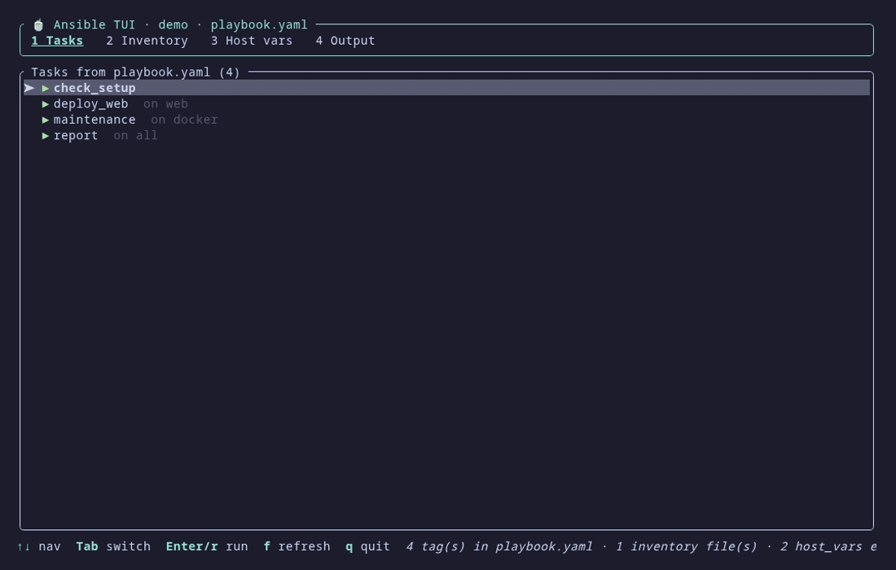

# Ansible TUI

A small terminal UI for an existing local Ansible project. It reads the actions
straight from `playbook.yaml`, runs one at a time, and shows what is happening
on every host — without remembering flags or scrolling through walls of text.



> **Status:** early-stage, deliberately small. It is a local launcher and
> viewer, not an orchestrator, a scheduler, or a replacement for AWX.

## Why

Running a tagged playbook by hand usually looks like this:

```bash
ansible-playbook -i inventory/all.ini playbook.yaml --list-tags
ansible-playbook -i inventory/all.ini playbook.yaml --tags update_site
```

This TUI turns that into a list you can navigate: pick an action, press Enter,
and watch a per-host summary and the live output. It stays out of the way and
keeps Ansible as the single source of truth.

## Features

- **Actions from the playbook itself**: tags are discovered with
  `ansible-playbook --list-tags`, so the list never drifts from the YAML.
  Play-level tags win; for plays without a play tag, the task tags are used.
  Tags of imported tasks do not become fake top-level actions.
- **Live run view**: per-host `ok` / `changed` / `failed` / `skipped` summary,
  current task, and streaming output.
- **Inventory browser/editor**: preview an inventory and edit it in place
  (`Ctrl-S` saves the real file).
- **Host vars browser**: read-only view of `host_vars/<host>.yml` files or
  `host_vars/<host>/` directories.
- **Tiny and local**: one Rust binary, no database, no daemon, no agents.
  Ansible does the actual work.

## Requirements

- [Ansible](https://docs.ansible.com/) with `ansible-playbook` in `$PATH`
- Rust 1.88+ to build from source (Linux or macOS)

## Install

```bash
git clone https://github.com/gabrielegenovese/ansible-tui.git
cd ansible-tui
cargo build --release

# optional: put it in your PATH
install -m755 target/release/ansible-tui ~/.local/bin/ansible-tui
```

Or, from the checkout:

```bash
cargo install --path .
```

Prebuilt Linux/macOS binaries are attached to GitHub releases once a `v*` tag
is pushed.

## Usage

```text
ansible-tui [PROJECT_DIR] [PLAYBOOK]
```

- `PROJECT_DIR` defaults to the current directory.
- `PLAYBOOK` is relative to `PROJECT_DIR` and defaults to `playbook.yaml`.

```bash
# run against the current project
ansible-tui

# run against another project
ansible-tui ~/infra/ansible

# use a playbook with a non-default name
ansible-tui ~/infra/ansible site.yaml
```

The equivalent command executed for the selected action is:

```text
ansible-playbook <playbook> --tags <selected-tag> -i <selected-inventory>
```

run from `PROJECT_DIR`.

### Expected layout

```text
my-ansible/
├── playbook.yaml          # the playbook whose tags become actions
├── inventory/
│   └── all.ini            # *.ini, *.yaml, *.yml, *.json
├── host_vars/             # optional; files or directories
│   ├── web1.yml
│   └── docker1/
│       └── vars.yml
└── tasks/                 # whatever your playbook imports
```

Ansible files outside `inventory/` and `host_vars/` are untouched: roles,
`group_vars/`, `ansible.cfg`, collections and so on keep working normally.

## Keys

### Global

| Key | Action |
| --- | --- |
| `1` / `2` / `3` / `4` | Tasks / Inventory / Host vars / Output |
| `Tab` / `Shift-Tab` | Next / previous screen |
| `↑` `↓` or `j` `k` | Move selection (scroll output on the Output screen) |
| `f` | Refresh files and re-read tags from the playbook |
| `q` | Quit |

### Tasks

| Key | Action |
| --- | --- |
| `Enter` or `r` | Run the selected action |

### Inventory

| Key | Action |
| --- | --- |
| `Enter` or `e` | Open the selected inventory in the built-in editor |
| `Ctrl-S` | Save the inventory file |
| `Esc` | Close the editor without saving the buffer |

### Host vars

Read-only preview; the selected file or directory is shown on the right.

### Output

| Key | Action |
| --- | --- |
| `↑` `↓` / `PgUp` `PgDn` | Scroll the log |
| `g` / `Home` | Jump to the oldest line |
| `G` / `End` | Jump back to the live tail |

## Demo

A ready-to-run demo project lives in [`demo/`](demo/):

```bash
cargo build --release
./target/release/ansible-tui demo playbook.yaml
```

It uses local connections only, so it does not touch any real machine. The
recording at the top of this README is generated from
[`docs/demo.tape`](docs/demo.tape) with [VHS](https://github.com/charmbracelet/vhs):

```bash
cargo build --release
vhs docs/demo.tape
```

## Limitations

This tool intentionally stays small. Current known limits:

- `ansible-playbook` must already be installed and configured.
- Runs one inventory at a time; no inventory switching during a run.
- No `--check`, `--diff`, `--limit`, extra vars, or ad-hoc commands yet.
- No vault prompt. Ansible still reads `ANSIBLE_VAULT_PASSWORD_FILE` and your
  `ansible.cfg`, but the TUI will not ask for a password interactively.
- Inventory editing writes the file directly, with no undo/backup.
- Host vars are read-only.
- Designed for local, interactive use on small/medium inventories — not for CI,
  scheduled jobs, or multi-user fleet management. For those, look at
  [ansible-navigator](https://github.com/ansible/ansible-navigator),
  [AWX](https://github.com/ansible/awx), or
  [Semaphore](https://github.com/semaphoreui/semaphore).

## Development

```bash
cargo fmt
cargo clippy --all-targets -- -D warnings
cargo test
```

CI runs formatting, Clippy (`-D warnings`) and tests on every push/PR. Pushing a
`v*` tag builds Linux x86_64 and macOS x86_64/arm64 archives.

## License

MIT — see [LICENSE](LICENSE).
